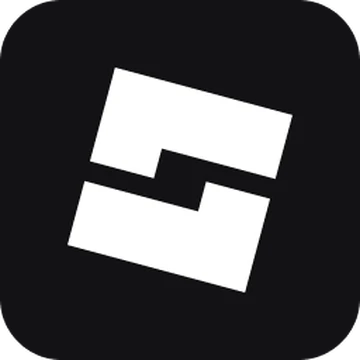
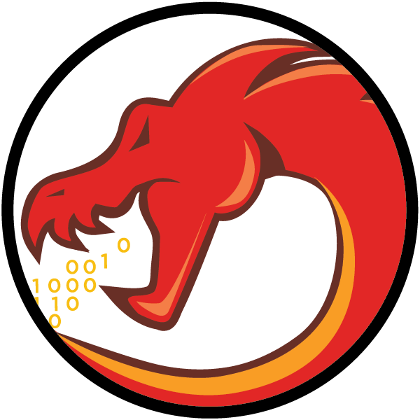
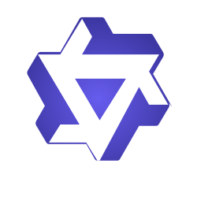
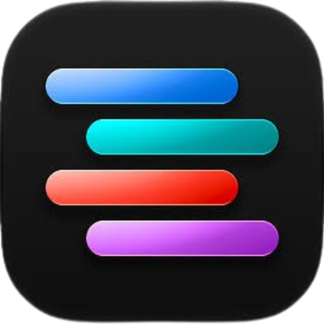
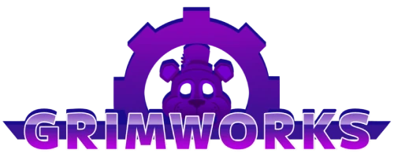

  

<h1 align="center">Backend Luau developer</h1>

  
  
  
  

<table align="center" cellpadding="14">
<tr><th>Languages</th><th>Frameworks</th><th>Tools</th><th>Agent</th></tr>
<tr><td valign="middle"> </td><td valign="middle">  </td><td valign="middle">     </td><td valign="middle"> </td></tr>
</table>

<h2 align="center">Contributions</h2>

<table align="center" cellpadding="14">
<tr><th>Game</th><th>Contribution</th><th>Links</th></tr>
<tr><td valign="middle" align="center"> <strong>Grimworks</strong></td><td valign="middle" align="center"><strong>Backend Developer</strong> Luau OOP backend systems</td><td valign="middle" align="center"> </td></tr>
</table>

<picture>
  <source media="(prefers-color-scheme: dark)" srcset="https://raw.githubusercontent.com/thelucas128/thelucas128/output/minesweeper-contribution-graph-dark.svg?v=3" />
  <source media="(prefers-color-scheme: light)" srcset="https://raw.githubusercontent.com/thelucas128/thelucas128/output/minesweeper-contribution-graph.svg?v=3" />
  
</picture>

